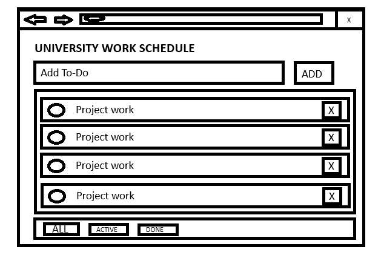
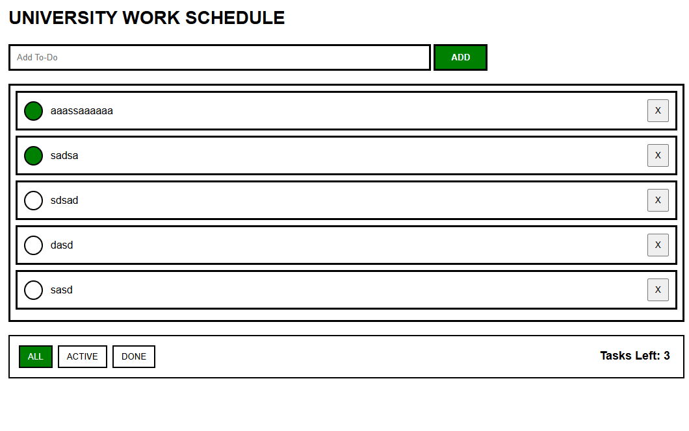

# Project 1: DOM Scripting

**Author(s):** Kevin Singh

## Project plan

### Project idea

The website is intended to be used by university students to track their coursework.

### Planned features

- Ability to add new items to your To-Do list
- Ability mark your tasks done
- Ability to Filter your tasks by All/Done/Active
- Ability to see how many tasks you have left to be done.

### Wireframe / sketch

## Web links

- **Published application:** [Add your GitHub Pages URL here](https://yourusername.github.io/your-repository/)
- **GitHub repository:** [Add your repository URL here](https://github.com/yourusername/your-repository)
- **Project video presentation:** [Add your video URL here](https://example.com/)

## About the application

**University To-Do list** is a web application that lets you keep track of your uni work.

## Technologies

- HTML – page structure
- CSS – styling and layout
- JavaScript – functionality, DOM scripting and form validation
- localStorage – saving / restoring data in the browser

## How to use the application

1. Open the published application using the link above.
2. Enter a task with at least 3 characters and click **ADD**.
3. Click the circle to mark a task complete or active. Click **X** to remove it.
4. Use **ALL**, **ACTIVE** or **DONE** to filter the list.
5. Refresh the page and check whether data remains available in the browser

## Running the application locally

1. Clone or download this repository to your computer.
2. Open the project folder.
3. Open `index.html` in a web browser.

## Screenshots

## Known issues / limitations

**No known issues.**

## Self-assessment and learning reflection

- What did I succeed in? I succeeded in creating a new website to track my university work. I'm satisfied with my end product, and i feel like i met my goals.

- What was challenging? The most challenging part for me was probably creating the filter buttons.

- What would I improve if I had more time? I would probably create the demo video & properly comment my code, feature wise i'd add a way to edit these to-do tasks.

- What did I learn about HTML, CSS, JavaScript and DOM scripting? I already had some basic experience with HTML, CSS and many other programming languages, but DOM scripting was new to me. I learnt how I can use dom scripting with html & css to make pages more interactive.

- What remained unclear or what would I like to learn more about? I'd like to go deeper into DOM scripting next time to build something more complex.

- My self-assessed project grade: **6/10 points**

## Sources and acknowledgements

- Course Workshop materials from github
- AI tool used: ChatGPT
  - How the tool was used:
    - Planning in what order I do my work.
    - Explaining how certain things worked.
      - For example; I gave it a code snippet that i didn't understand fully understand and asked it to explain its logic. 
    - Basic help on code syntax

## License

This project is licensed under the MIT License.

More information about adding a license to a GitHub repository:  
https://docs.github.com/en/communities/setting-up-your-project-for-healthy-contributions/adding-a-license-to-a-repository