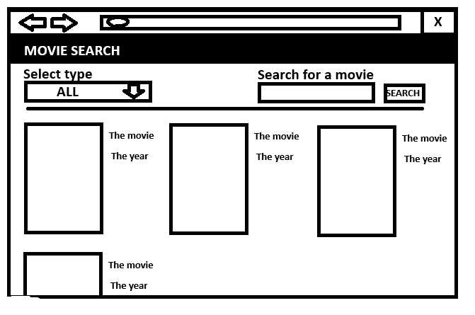
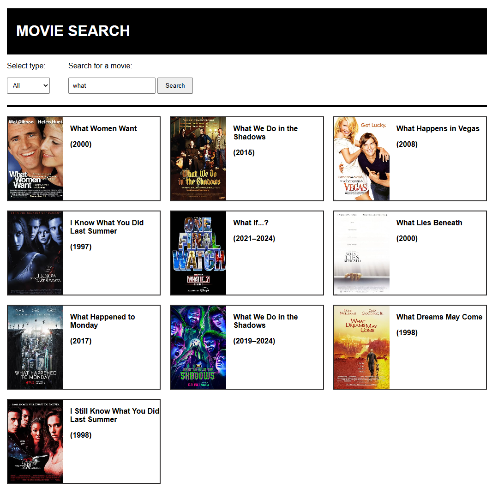

# MOVIE SEARCH

**Author(s):** Kevin Singh

## Project plan

### Project idea

The purpose of this website is to be able to search for movies.

### Planned features

- Ability to search for movies
- Ability to filter movies / series / episodes.
- Ability to see the movie title / poster / year

### Wireframe / sketch

## Web links

- **Published application:** https://endearing-beijinho-d727fd.netlify.app/
- **GitHub repository:** https://github.com/KevinSingh65/Kevin-laurea-web-development-FrontEnd

## About the application

**[MOVIE SEARCH]** is a web application that allows you to search for movies / series / episodes from the OMDB API

## Technologies

Describe the technologies you used and their role in your project.

- HTML – page structure
- CSS – styling and layout
- JavaScript – functionality, DOM scripting
- AJAX - retrieving movie data from OMDB API

## How to use the application

Write short instructions for using the application.

1. Open the published application using the link above.
2. Select a search type (All, movie, series or episode)
3. Enter the movie title into search bar and click search
4. See the movie title, poster and release year.

## Running the application locally

1. Clone or download this repository to your computer.
2. Open the project folder.
3. Open `index.html` in a web browser.

## Screenshots

## Known issues / limitations

**missing poster images sometimes appear in search results.**

## Self-assessment and learning reflection

Reflect on your work and learning process.

- What did I succeed in?
  + i succeeded in creating a movie search website.
- What was challenging?
  + Figuring how to show the API data. & I was originally planning on using the finnkino API, but couldn't get it to work.
- What would I improve if I had more time?
  + The design
- What did I learn about HTML, CSS, JavaScript and DOM scripting?
  + I learnt about using APIs to retrive and display data.
- What remained unclear or what would I like to learn more about?
  + I could learn more about other APIs.
- My self-assessed project grade: **7/10 points**

## Sources and acknowledgements

- https://www.omdbapi.com/
  + to get the API key & parameters.

- Course Workshop materials from github

- AI tool used: ChatGPT
  - How the tool was used:
    + Helping me to decide what to make the project about + planning in what order I do my work.
    + Explaining how certain things worked.
      + For example; I gave it a code snippet that i didn't understand fully understand and asked it to explain its logic. 

- AI tool used: github copilot
  - How the tool was used:
    + code autocomplete suggestions and recommendations

## License

This project is licensed under the MIT License.

More information about adding a license to a GitHub repository:  
https://docs.github.com/en/communities/setting-up-your-project-for-healthy-contributions/adding-a-license-to-a-repository